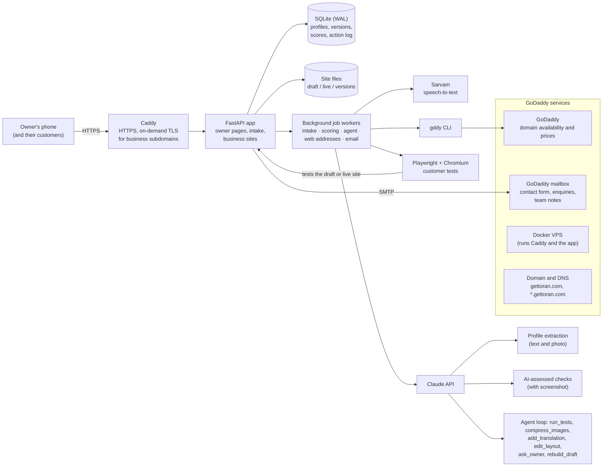

# Toran

**Speak your business. Get your website.** A home baker, tailor or beauty parlour owner describes the business by voice in Marathi, Hindi or English, and Toran builds a mobile-first website, tests it like a customer would, and improves it before the owner says yes.

**Try it, no sign-up:** https://gettoran.com → tap one of the three sample voice notes.

**Headline:** a voice note becomes a tested draft website in minutes, and in a real run (real Claude, real browser) Toran's agent raised a demo draft's Readiness Score from 85 to 87 on its own, for about $0.24. Real-world accuracy: <!-- TODO(Sakshi): fill in --> **[to be filled in]**.

---

## What it is and who it's for

Toran is a voice-first agent that takes a small business owner from idea to launch. It is for small business owners in India who find websites and technology a barrier, starting with home-based businesses: home bakers, beauty parlours, tailors and tutors. If you can describe your business in Marathi, Hindi or English, Toran can put it online. Our first real users are women running businesses from home in Pune.

1. The owner describes the business by voice (or sends a photo of the price list, or types).
2. Claude turns it into a business profile. The owner checks each detail on simple cards; anything unclear becomes a question, never a guess.
3. Toran builds a fast, three-language website (English, Hindi, Marathi) on `<business-name>.gettoran.com`.
4. A real browser tests the site like a customer on a slow phone and gives a **Customer Readiness Score** (0 to 100).
5. An agent improves a draft copy, re-tests it, and shows the owner the score before and after. Nothing goes live until the owner approves.
6. Toran can suggest a web address with real GoDaddy prices; the team buys it only after the owner asks.
7. Later, the owner edits the menu and prices from the owner page ("Edit my menu and prices"). The changes go to a draft the owner can preview and go live only after the owner approves. "Restore the previous menu" undoes an edit, and big price changes need the PIN again. Phone, area and ordering policy are in "My details".

## What to try (about 5 minutes)

1. **Tap a sample voice note** on https://gettoran.com ("Try it in 3 languages"). No microphone or sign-up needed.
2. **Confirm the cards**: check the details Toran heard, then press "Confirm my details". Save the private link and PIN it shows once.
3. **Open the owner page** with that link and PIN, and look at the **draft score** and "See the full report" (each item says how to fix it).
4. **Press "Let Toran improve my draft"**, wait for it to finish, then open **"See how Toran thinks"**: before and after first, then every round, tool call and score change, with "Details for judges".
5. **Tap "Edit my menu and prices"**, change a price, and save: the draft is rebuilt and tested again, and the live site changes only when you publish. Try "Restore the previous menu" too.
6. **Open a live demo site in another language**, for example https://asha-home-bakery.gettoran.com/mr/ or https://savitri-gruh-udyog.gettoran.com/hi/.

## How it maps to the judging criteria

| Criterion | Evidence | Where |
| --- | --- | --- |
| **Impact (35%)** | Built for small business owners in India who find technology a barrier, starting with home-based businesses (first real users: women running businesses from home in Pune); voice in Marathi, Hindi and English; sites readable in all three; real vs sample businesses tracked; accuracy measured on real voice notes; cost per business measured | `app/services/accuracy.py`, `scripts/accuracy_report.py`, `app/services/showcase.py` ("Measured on the live system"), real-world results below |
| **Demo (35%)** | One-tap samples, no sign-up; the score improves visibly; "How Toran thinks" panel; friendly messages instead of errors (spend cap, Claude down, stuck jobs); works at 360 px to 1280 px | `app/templates/app/home.html`, `app/templates/app/owner_agent.html`, `tests/test_layout.py` |
| **Tech Usage (15%)** | Claude agent loop with six guarded tools, vision (price-list photos), structured outputs, prompt caching, cost logging and a daily cap; GoDaddy CLI for live domain availability and prices, DNS, VPS and mailbox | "How it uses Claude" and "How it uses GoDaddy" below |
| **Execution (15%)** | Layered FastAPI app (thin routes, services, swappable providers), Alembic migrations, 777 tests including real-Chromium layout and end-to-end checks, ruff, mypy, gitleaks, pip-audit, CI on every push, an independent code review with fixes | `docs/review.md`, `.github/workflows/ci.yml`, `tests/` |

## Architecture



- Routes stay thin (`app/routes/`); logic lives in `app/services/`; providers (Claude, speech-to-text, GoDaddy CLI, SMTP) sit behind interfaces with mock versions.
- Browser tests and the agent run as background jobs (`app/services/jobs.py`); pages refresh themselves while they wait.
- Business sites are static files built from the confirmed profile (`app/services/sitegen.py`) and served on their own subdomain.

## How it uses Claude

Every call goes through `ClaudeClient` (`app/services/claude_client.py`): `max_tokens`, a timeout, retries with backoff, prompt caching of the system prompt (and tools), token and cost logging per business, and a daily spend cap (`check_spend_cap`, with 30% reserved for existing businesses, `RESERVED_SHARE`). Mock mode (`CLAUDE_MOCK=1`) answers from `tests/fixtures/claude/`.

| Use | Model | Where |
| --- | --- | --- |
| Voice transcript or price-list photo (vision) → business profile, as validated JSON | Sonnet | `extract_profile` in `app/services/extract.py` |
| AI-assessed score items (language clarity, policy, customer questions), judged with the phone screenshot | Sonnet | `run_ai_checks` in `app/services/ai_checks.py` |
| Agent fix loop with tool use: reads score items, calls tools, re-tests, up to 5 rounds | Sonnet | `AgentLoop` in `app/services/agent.py` |
| The six tools, each checked in code before anything changes (a price or fact change is rejected) | — | `TOOL_DEFINITIONS`, `apply_tool`, `translation_problem` in `app/services/agent_tools.py` |
| Web address name suggestions | Haiku | `suggest_names` in `app/services/godaddy.py` |
| Eval name judge | Haiku | `app/services/evals.py` |

Text from voice notes, photos, websites and forms is passed to Claude as data inside tagged blocks (angle brackets neutralised), never as instructions.

## How it uses GoDaddy

| Use | Where |
| --- | --- |
| **Domain availability and first-year prices** inside the product: 6 suggested names × `.in` and `.com`, each checked with `gddy domain available <domain> --check-type full --json`, shown as tool calls in the owner's view | `GddyCli`, `command_for`, `run_lookup` in `app/services/godaddy.py` |
| **Nothing bought from the app**: "I want this one" records the request and emails the team, who buy it on godaddy.com and point DNS | `request_domain` in `app/services/godaddy.py`, `app/services/mail_jobs.py` |
| **Pinned, checksum-verified gddy CLI** in the Docker image; `/health` reports it; authenticates with `GDDY_PAT` | `scripts/install_gddy.py`, `Dockerfile` |
| **Domain and DNS**: gettoran.com, with `A` records for `@`, `www` and `*` (every business subdomain) | `docs/deploy.md` |
| **Docker VPS** running Caddy and the app | `docker-compose.yml`, `Caddyfile`, `docs/deploy.md` |
| **Mailbox** on our domain over SMTP: contact form, enquiry notifications, team notes, error alerts | `send_mail` in `app/services/mailer.py` |

## Safety and privacy

- **Nothing goes live without the owner's approval.** The agent works on a draft only; publishing is a separate confirmation screen. A real business can't go live without a phone number unless the owner explicitly chooses no order button.
- **Facts only from the owner's confirmed details.** Prices and numbers are inserted from the profile, never written or translated by Claude; agent tools that try to change a fact are rejected and logged.
- **No home address.** Anything that looks like an address is left off the site and turned into a question.
- **Owner access:** an unguessable private link plus a hashed 4-digit PIN, lockout after 5 wrong tries, the PIN again to change the phone number or delete the site, remembered devices revocable, and a team-only reissue after checking the owner's identity (`make server-access`).
- **Retention:** voice notes and price-list photos deleted right after processing (30 days if the owner chose to keep them); unconfirmed starts after 7 days; sample businesses after 7 days; enquiries after 90 days; logs after 30 days; backups kept 7 days. See `/privacy` in all three languages.
- **One-action deletion** of the owner's site and all data, with a permanent-deletion warning and the PIN.
- **Security patterns:** CSRF on every form (Origin check for the cross-site enquiry form), rate limits, upload checks (re-encoded images, location data stripped), security headers, non-root container, secrets only in `.env` (never in the repo or its history; gitleaks in pre-commit).

## Measured vs AI-assessed

Each score item records whether it is `measured` or `ai_assessed` (`app/services/score.py`, `docs/score.md`).

- **Measured** by real Chromium (median of three runs): time to main content on slow internet, page weight, order button visible on a phone, tap targets at least 44 px, no sideways scrolling, nothing overflowing on a laptop, phone number shown, delivery area shown with no address, HTTPS (live site).
- **AI-assessed** by one Claude call per test run: language clarity on each language page, real photos, ordering policy, customer questions answered (`docs/checklists.md`). Points come from fixed verdicts (yes, partly, no), so repeated runs stay close.

## Cost per business (measured)

- **One full check** (customer tests plus the AI checks): about **$0.05** in Claude cost.
- **One agent run**: **$0.05 to $0.17** in Claude cost, plus the AI checks of each re-test.
- Every call's tokens and estimated cost are stored per business (`claudeusage` table); speech-to-text minutes and estimated cost in `sttusage`. The home page shows measured medians with their sample size and date.

## Real-world results

<!-- TODO(Sakshi): fill in the real-world numbers below. -->

| Measure | Result |
| --- | --- |
| Real businesses onboarded | **[to be filled in]** |
| Field accuracy on real voice notes | **[to be filled in]** |
| Price accuracy on real voice notes | **[to be filled in]** |
| Median time from voice note to a tested draft | **[to be filled in]** |
| Pune audit (small, non-random sample) | **[to be filled in]** |

`make accuracy` prints the accuracy and timing report from real (non-sample) businesses.

## Setup on a new machine

```bash
make setup                 # virtualenv, pinned and hashed dependencies, pre-commit hooks
cp .env.example .env       # fill in values; APP_ENV=development locally
make migrate
make seed                  # six demo businesses, marked Sample
make dev                   # http://localhost:8000
```

Everything works in mock mode (`CLAUDE_MOCK=1`, `GDDY_MOCK=1`, `STT_PROVIDER=mock`) without spending credits.

## Tests and checks

```bash
make lint      # ruff, formatting, mypy, gitleaks, private-files hook, whitespace (pre-commit)
make test      # 777 tests, mock mode, including real-Chromium end-to-end and layout checks
make eval      # extraction evals (evals/), checked in code
```

- **Layout check** (`tests/test_layout.py`): every owner page in every state, the home page, `/start` and live business sites, at 360, 768, 1024 and 1280 px; fails if any element sticks out of its card or is wider than the screen. `LAYOUT_SHOTS=<folder>` saves screenshots.
- **CI** (`.github/workflows/ci.yml`) runs the hooks, the tests and `pip-audit` on every push.
- **Translations:** `make i18n-sheet` writes `docs/translation-review.md` for native speakers; `make i18n-apply file=<filled copy>` applies their fixes and refuses any that change a placeholder or number.

## Production deployment

Docker Compose on the GoDaddy VPS: the app (non-root, `init`, 1 GB shared memory for Chromium) and Caddy (HTTPS, on-demand certificates for business subdomains, allowed only for real businesses). Migrations run on start, the app makes a daily backup, and tagged images allow a one-command rollback. The step-by-step server checklist, the spend-cap behaviour and how to give an owner a new link and PIN are in [docs/deploy.md](docs/deploy.md).

## Known limitations

- **Prices and menu can be edited only by typing, not by voice.** Owners edit them on the owner page; updating them by voice is a next step.
- **Owners are not notified by WhatsApp or email when a customer's form message arrives.** It appears in the enquiries inbox on the owner page and is emailed to the Toran team.
- **One agent run per draft at a time.**
- **The Pune audit is a small, non-random sample**, so its numbers show direction, not a population estimate.
- **Speech-to-text can mishear**, especially names and numbers, which is why the owner confirms every detail before anything is built.
- **AI-assessed score items can vary by a point or two** between runs of the same site.
- **Hindi and Marathi wording was written by AI** and is being reviewed by native speakers (`docs/translation-review.md`).
- Rate limits are kept in memory (one app process), and the rupee figure for domain prices uses a fixed rate.

## Next steps

- Price and menu updates by voice, using the same draft, restore and PIN rules as the menu editor.
- Notify owners on WhatsApp when a customer sends an enquiry.
- Finish the native-speaker review of Hindi and Marathi, then add more Indian languages.
- Automate buying and DNS setup for a requested web address, still only after the owner's approval.
- A larger, random sample of real businesses for the accuracy audit.

## Repository

- `app/`: FastAPI app (`routes/`, `services/`, `templates/`, `i18n/`, `static/`)
- `migrations/`: Alembic migrations · `scripts/`: operations scripts · `tests/`: test suite
- `docs/`: score rules, checklists, deployment, review, translation review
- `evals/cases/`: fake sample cases only; real cases live in git-ignored `evals/private/`
